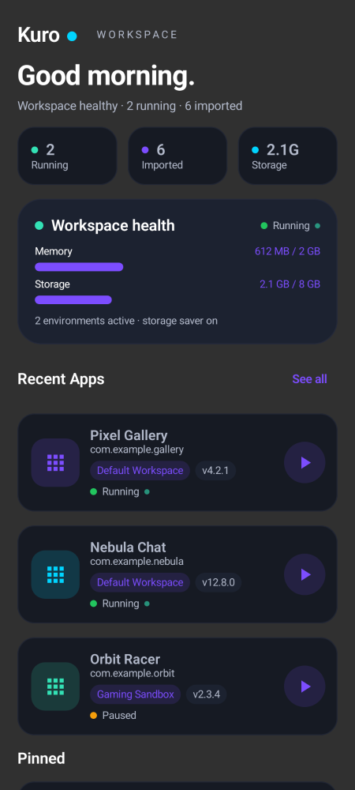
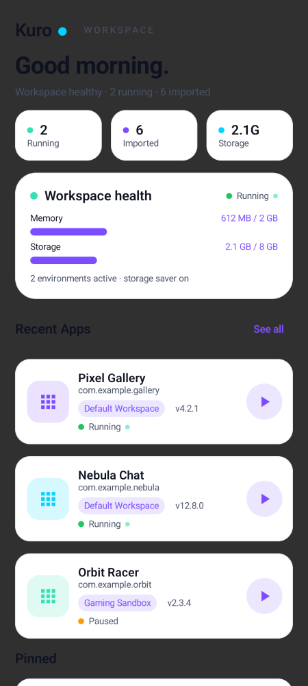
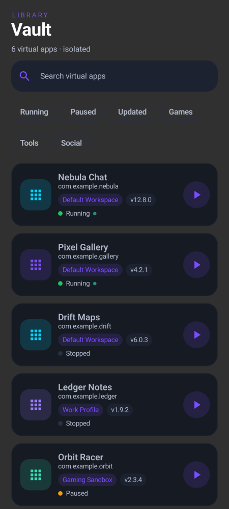
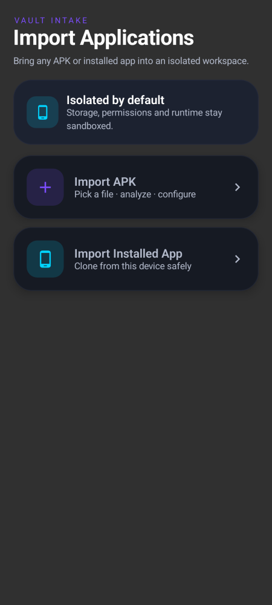
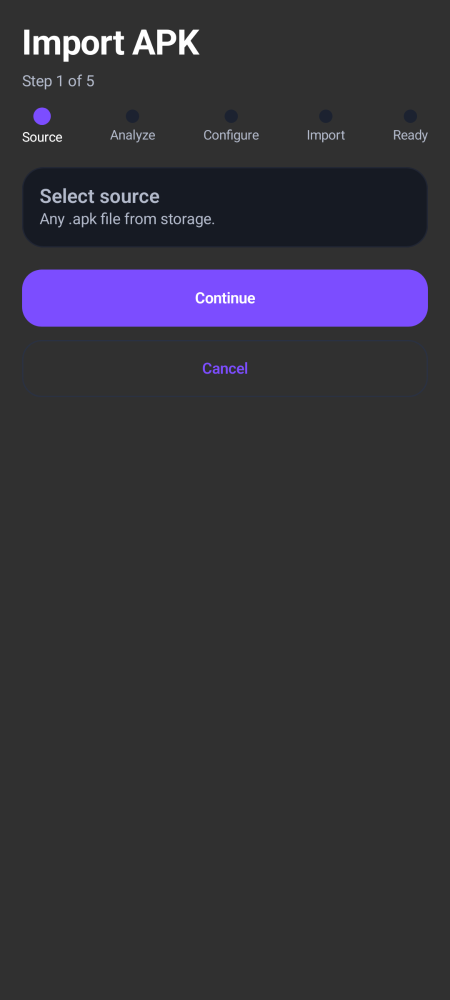
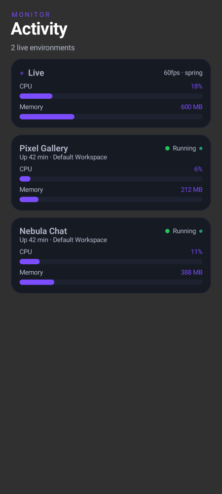
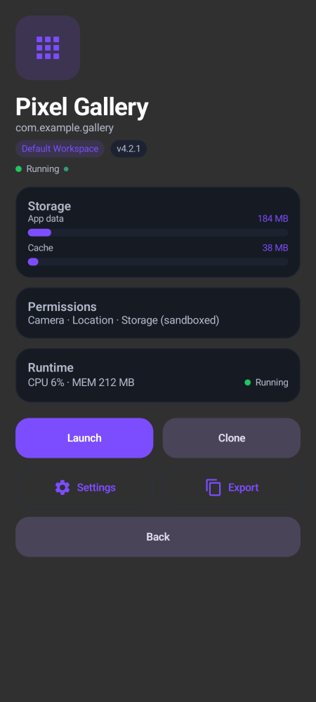
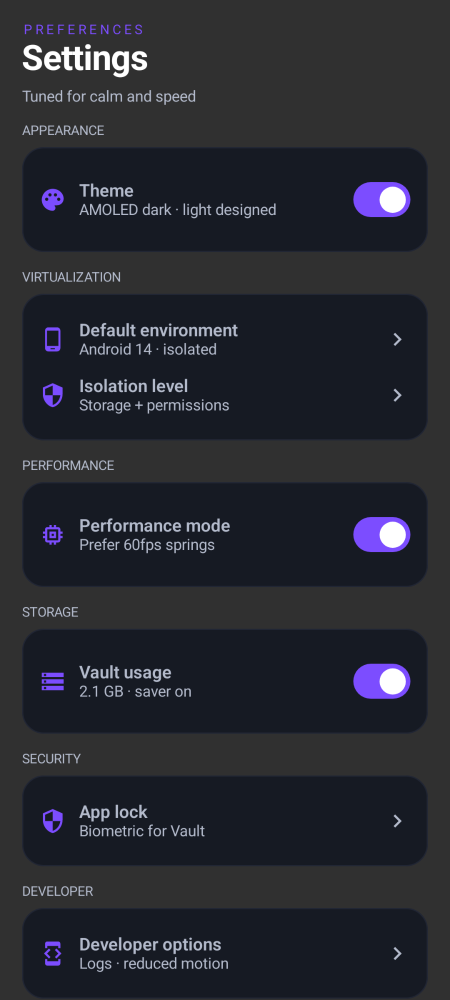
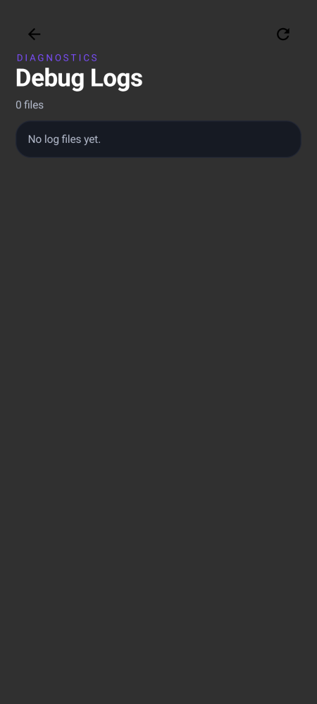

# KURO — Visual Review Report

Redesign verified against JVM-rendered screenshots (Paparazzi, PIXEL_6,
`screenshots.yml`, run `38362889103`). Every image below is generated from the
current source — no mockups.

## Design language

- **AMOLED-first dark** (`#0B0D13` background, `#12151E` surface, `#161A23`
  cards, `#1C2230` elevated) plus a separately-designed light theme (paper
  `#F7F7FB`, white cards). Accents are purple `#7C4DFF` + cyan `#00D4FF` only.
- **Identity over defaults:** every card carries a 1dp hairline border in the
  outline color (`KuroCard.kt`), so surfaces read as layered hardware instead
  of flat Material sheets. Iconography sits in duotone tiles (16% tint tile +
  full-tint glyph) so each app keeps a recognizable color without random hues.
- **Hierarchy:** letterspaced purple eyebrow → display title → muted subtitle
  on every screen (`KuroScreenTitle`, `BrandHeader`). Body copy is always an
  explicit `onSurfaceVariant`; titles are explicit `onBackground` — never the
  ambient content color (see finding F-2).
- **Motion:** spring press states (0.97 scale), `animateItem` list physics on
  filter/sort, animated meters, shimmer skeletons. No spinners, no launch-time
  enter animations (startup-safety policy).

## Screens

### Home (dark + light)
 

- `BrandHeader`: "Kuro ●" wordmark with cyan dot + letterspaced "WORKSPACE"
  gives the product a signature in 2 lines; greeting stays Display/32 Bold.
- Mini stat strip (Running / Imported / Storage) answers "what's my state"
  without scrolling; colored dots reuse the status language.
- `Workspace health` hero (28dp, elevated surface) groups the two meters that
  matter; footer line confirms saver state. Value labels are primary-purple so
  numbers scan before labels.
- `AppCard`: 56dp duotone tile, name + package (muted, ellipsized), env +
  version badges, pulsing status, circular tonal launch button. One row carries
  everything — no second tap needed to launch.
- Recommended card is the only purple-tinted surface in the app, reserved for
  the single primary CTA (import). Light mode keeps the same structure with
  white cards and ink text — not an inversion.

### Vault

- Eyebrow "LIBRARY" + count subtitle ("6 virtual apps · isolated").
- Filled search (borderless tonal field, purple focus ring) instead of the
  generic outlined box; filter chips cover status + category; list reorders
  with `animateItem` physics on every keystroke/tap.
- Running items sort first; empty query state reuses the illustrated
  `KuroEmptyState` ("No Virtual Apps Yet" + Import action).

### Import

- The money screen: eyebrow "VAULT INTAKE", hero strip restating the
  isolation promise, then two 28dp floating cards with duotone tiles
  (purple = file, cyan = device) and spring press physics.

### Import flow

- Five-step modern stepper (dot + label, no wizard chrome); step body swaps
  with `AnimatedContent`; primary/ghost button pair; progress copy ("Step 1
  of 5") in the subtitle slot.

### Activity

- Eyebrow "MONITOR"; live card with pulsing dot + 60fps caption; per-env
  cards repeat the meter language from Home so numbers are comparable.

### App detail

- Oversized duotone tile + display name + package + badges + status, then
  Storage (meters) / Permissions / Runtime cards, then Launch (primary) +
  Clone (tonal) + Settings/Export (outlined) + Back. Actions in thumb order.

### Settings

- Uppercase group labels, one bordered card per group, purple-tinted icons,
  switches only where state exists. About card hides Debug Logs behind 5 taps.

### Debug logs

- Crash reports (red) separated from session logs; inline viewer with
  Copy/Share/Export/Delete; empty state when clean.

## Review findings (fixed this pass)

- **F-1 duplicate LazyColumn keys** (`HomeScreen.kt`): Recent (`1,2,3`) and
  Pinned (`1,2`) blocks shared item ids → `IllegalArgumentException: Key "1"
  was already used` the moment both sections materialize. On tall/large-font
  viewports that is the first frame — the launch crash. Fixed with
  `recent-`/`pinned-` key namespaces; all other lists audited unique.
  Caught by Paparazzi (`homeDark`/`homeLight` red before fix, green after).
- **F-2 invisible titles on dark theme**: title `Text`s relied on the ambient
  content color (black) with no `Surface` above the screens. Fixed at both
  layers: `NavHost` wrapped in a background `Surface`, and all title
  components pin explicit `onBackground` (`SectionHeader.kt`,
  `AppDetailScreen.kt`, `KuroEmptyState.kt`). Verified white in re-renders.
- **F-3 Paparazzi 1.3.2 layoutlib/Guava `IllegalAccessError`**: bumped to
  1.3.5; 14/16 green immediately, exposing F-1.

## Startup-safety audit (launch path today)

`KuroApp` (guarded log init + crash handler) → `MainActivity` (one log line,
`enableEdgeToEdge`, `setContent`) → `KuroTheme` (static palette pick, zero
IO) → `NavHost(start=Home)` → `HomeScreen` (static first frame). Removed from
startup: splash destination + delay + navigate race, dynamic-color resolution,
all enter animations, Coil/Lottie dependencies. Every remaining startup call
is synchronous, offline, and exception-guarded.
